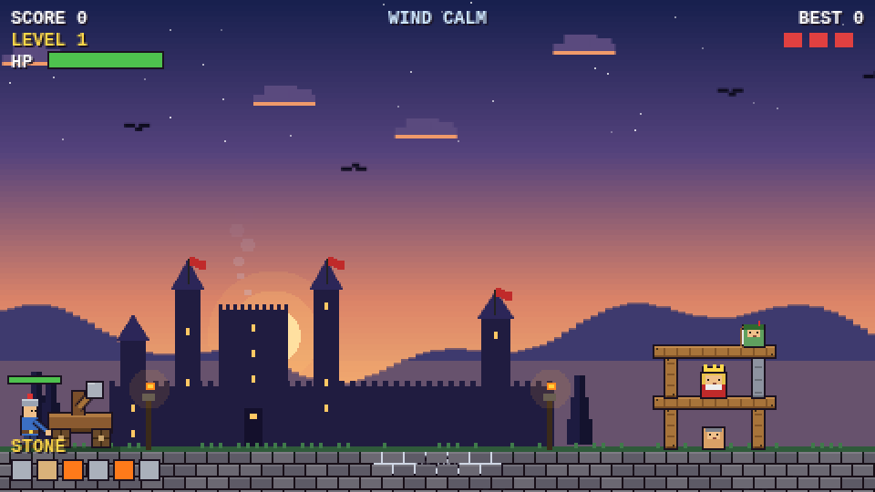
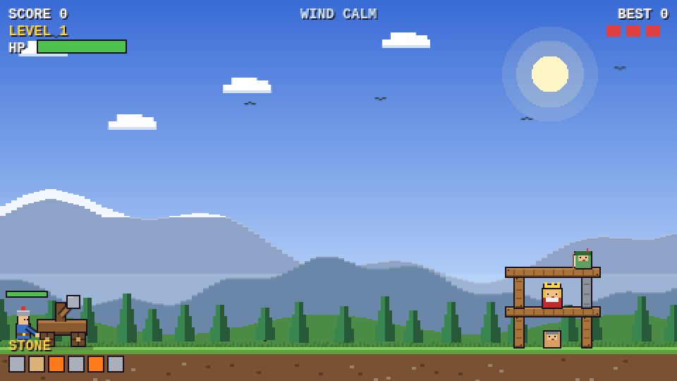
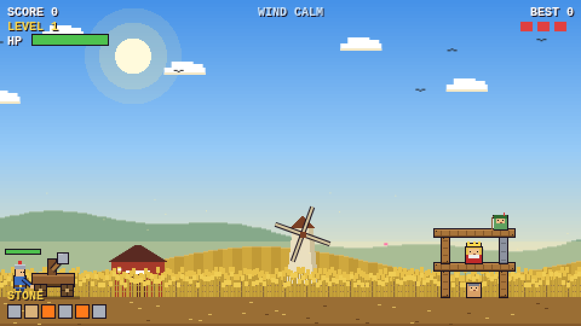
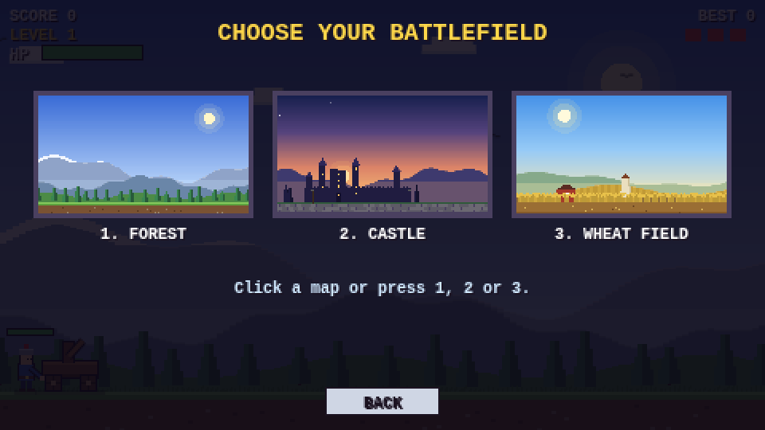

# Siege Smash

A pixel-art medieval catapult game that runs entirely in the browser. Aim your catapult, topple the hidden king, and survive the enemy archers across endless, ever-harder levels.



| Forest | Wheat field | Map select |
|---|---|---|
|  |  |  |

## Features

- **Three maps**: Forest, Castle and Wheat Field, each with animated details (birds, flags, torches, smoke, windmill, swaying wheat).
- **Four projectiles**: stone, split rock (tap mid-air to split into 3), fireball (ignites wood), boulder (crushes stone and iron).
- **Destructible castles** made of wood, stone and iron, simulated with [Matter.js](https://brm.io/matter-js/).
- **Enemy archers** shoot back. Eight arrows take you down, and the number of archers grows with the level.
- **Endless levels** with rising difficulty: taller castles, tougher materials, more enemies, a deeper-hidden king, and wind.
- **Scoring and stars** based on ammo left, damage dealt and remaining HP. Best score is saved in your browser.
- In-game **guide**, 8-bit sound effects and music, mute switch.

## How to play

1. Press and hold the catapult, drag back, release to fire. White dots show the first part of the path.
2. Tap while a split rock is flying to split it.
3. Topple the king to win the level. Running out of ammo or HP costs one of your 3 lives.

Keys: `M` mute, `1` `2` `3` choose a map, arrow keys / Enter / Esc in the guide.

## Run it

It is a static site, so there is no build step.

- **Double-click** `index.html`, or
- serve the folder: `python -m http.server 8080` and open http://localhost:8080, or
- with Flask (Replit-friendly): `pip install -r requirements.txt && python main.py`.

An internet connection is needed because Matter.js is loaded from a CDN (cdnjs, with a jsDelivr fallback).

## Deploy to GitHub Pages

1. Push this repository to GitHub.
2. Go to **Settings -> Pages**.
3. Under **Build and deployment**, choose **Deploy from a branch**, branch `main`, folder `/ (root)`.
4. Save. After a minute the game is live at `https://<your-user>.github.io/<repo-name>/`.

## Project structure

```
.
├── index.html        Page shell: canvas and buttons
├── css/style.css     Page and button styles
├── js/game.js        All game code (physics, AI, drawing, maps, guide, audio)
├── docs/             Screenshots used in this README
├── main.py           Optional Flask static server (Replit / local)
├── requirements.txt  Python dependency for main.py
├── .replit           Replit run configuration
├── .nojekyll         Tells GitHub Pages to serve files as-is
├── .gitignore
├── LICENSE
└── README.md
```

## Tweaking the game

All in `js/game.js`:

| What | Where |
|---|---|
| Block / enemy / projectile stats | tables `M`, `E`, `P` |
| Level layout, archer count, wind, ammo | function `load()` |
| Arrow damage and fire rate | function `gameAI()` (`php-=12.5`, `a.cd=...`) |
| Map artwork | `SKY`, `LAND`, `DYN` arrays |
| Guide text | array `GP` |

## License

MIT, see [LICENSE](LICENSE). Replace `YOUR NAME` in the license with your own name before publishing.
